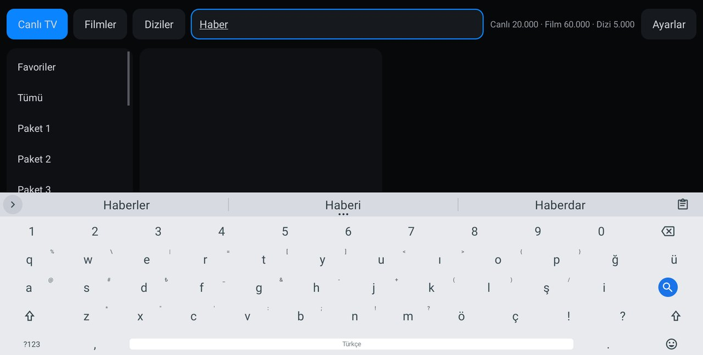

<p align="center"></p>
<h1 align="center">M2Y Board</h1>
<p align="center"><b>A lean, offline Turkish Q keyboard built for the BYD multimedia screen</b><br><sub>BYD multimedya ekranı için sade, çevrim dışı Türkçe Q klavye · Лёгкая офлайн-клавиатура с турецкой раскладкой Q для мультимедийного экрана BYD</sub></p>
<p align="center">
  <a href="https://github.com/mehmetmesut/byd-m2y-board/releases/latest"></a>
  <a href="https://github.com/mehmetmesut/byd-m2y-board/releases"></a>
  
  
  
  
</p>
<p align="center">
  <a href="https://github.com/mehmetmesut/byd-m2y-board/releases/download/1.25.07.68.0/M2YBoard_1.25.07.68.0.apk"><b>⬇ Download APK (4.5 MB)</b></a> ·
  <a href="https://byd.mehmetmesut.com">byd.mehmetmesut.com</a> ·
  <a href="https://github.com/mehmetmesut/byd-m2y">⭐ All M2Y apps for BYD</a>
</p>
<p align="center"></p>

<details open>
<summary><b>🇬🇧 English</b></summary>

### Why this app

I built M2Y Board first for **my own BYD SEAL U DM-i** because the store apps did not fit the car: ads, Google Play dependencies, phone and TV layouts, and a heavy load on the CPU. The stock keyboard of DiLink 3.0 is built around Chinese input, and most keyboards from the stores need Google services or send what you type online. Then I made the app installable and usable on **BYD multimedia screens (DiLink)** and share it **free, without ads, without tracking**. It is built to use **as little of the head unit's CPU, RAM and storage as possible**: fast to open, smooth to touch, stable.

### Highlights

- **Turkish Q out of the box** – enabled and selected on a fresh install whatever the system language is; Russian (Cyrillic) layout and dictionary are bundled too.
- **100 % offline** – the app declares no internet permission and nothing it stores is backed up.
- **Made for 1920×1080** – keyboard height 82 % so the input field stays visible, number row always on.
- **Clipboard one tap away** – the clipboard button is permanently pinned on the toolbar.
- **Small** – 4.5 MB APK, arm64 native libraries only.
- **No data collection** – the gesture-data collection of the upstream keyboard is removed completely.

### Features

- Turkish Q layout (ı, ğ, ü, ş, ö, ç, ₺) with Turkish dictionary, suggestions and spell checker (about 1.2 MB dictionary).
- Russian (Cyrillic) layout with Russian dictionary (about 2.2 MB); switch it on in the keyboard's language settings.
- Number row on the alphabet and symbol layouts, with localized digits.
- Keyboard height set to 82 % of the default (tuned on the 1920×1080 / 240 dpi screen).
- Clipboard history with a button that is always visible on the toolbar; image and file copies are not written to disk. Entries are kept for 10 minutes by default.
- Emoji keyboard with search, reachable from the bottom row (long-press the comma key) and from the toolbar; a fixed emoji key can be turned on in the settings but is off by default.
- Toolbar with undo, redo, select word, copy, paste and cursor keys.
- Timestamp key format defaults to `dd-MM-yyyy HH:mm:ss` (day first).
- No microphone key (the head unit has no voice input service for it).
- Simplified settings: the advanced, layout, dictionary and gesture screens are removed and those options keep their tuned defaults.
- Defaults that save CPU: gesture (swipe) typing off and no gesture library shipped, emoji suggestions off, key sound and vibration off.
- Based on HeliBoard: autocorrect, next-word suggestions, long-press popup keys, themes, one-handed mode and the rest of the upstream editing features stay available.

### Built for the head unit

| Head unit fact | Design decision |
|---|---|
| Android 10 (API 29), arm64-v8a, no Google services | No Google or Play dependency, no internet permission; the release APK carries arm64 native libraries only (4.5 MB) |
| 1920×1080 landscape touch screen, 240 dpi | Keyboard height 82 % so the text field stays visible, number row always on |
| Turkish owner, occasional Russian | **Turkish Q** is enabled and selected on a fresh install regardless of the system language; Russian layout and dictionary bundled |
| Qualcomm SM6125, must never stutter | Gesture typing off with no gesture library shipped, emoji suggestions off (no extra dictionary lookup per word), no clipboard file copies, no sound or vibration by default |
| Copy and paste while parked | Clipboard button always visible on the toolbar; emoji one long-press away on the bottom row |
| No voice input service | No microphone key |
| Privacy and a quiet settings screen | Gesture-data collection removed (active and background collection, review and share screens, its database table); advanced, layout, dictionary and gesture screens removed |

### Install

On a head unit with wireless ADB enabled:

```
adb connect <car-ip>:5555
adb install -r M2YBoard_1.25.07.68.0.apk
adb shell ime enable com.m2y.board/helium314.keyboard.latin.LatinIME
adb shell ime set com.m2y.board/helium314.keyboard.latin.LatinIME
```

Instead of the two `ime` commands you can open M2Y Board from the launcher and follow its setup wizard, or enable the keyboard in the system's keyboard settings.

- **Windows one-click installer:** https://byd.mehmetmesut.com/m2y-kurulum.cmd – asks for the car's IP, downloads Google's platform-tools if missing, downloads the chosen apps, verifies SHA-256 and installs.
- **Direct install from the car's browser** only works on head units whose **stock BYD package installer has been unlocked** (the stock one blocks third-party APKs with a "driving safety" notice). This project does not distribute BYD files.
- All M2Y APKs are signed with the same M2Y key, so updates install over the previous version and keep your settings.
- After installing, the SealNav / stock launcher may need a restart to show the new icon.
- SHA-256 sums are listed at https://byd.mehmetmesut.com.

### Privacy & permissions

The app has **no internet permission** and `allowBackup` is off, so typed words and the clipboard history never leave the device and are not part of any backup. The manifest declares:

| Permission | Why |
|---|---|
| `READ_USER_DICTIONARY` / `WRITE_USER_DICTIONARY` | Read and write the system user dictionary (your own saved words) |
| `READ_CONTACTS` | Only for the optional contact-name suggestions; the option is **off by default** |
| `RECEIVE_BOOT_COMPLETED` | Lets the keyboard get ready after boot, after an app update and after a language change |
| `VIBRATE` | Optional key vibration; **off by default** |

Never collected: no analytics, no crash reporting, no advertising, no tracking, no gesture data, no account.

### Compatibility

Designed and tested on the BYD SEAL U DM-i (DiLink 3.0). Other BYD models with an Android 10+ arm64 multimedia screen are expected to work but are not tested.

Target head unit: BYD DiLink 3.0 · Android 10 (API 29) · no Google services · Qualcomm SM6125 (8 cores, 4×1.8 + 4×2.0 GHz), Adreno 610 · 8 GB RAM · arm64-v8a · 1920×1080 landscape touch screen, 240 dpi, 60 Hz.

### Build from source

Requirements: JDK 17 or newer (CI uses 17), Android SDK (compileSdk 37), NDK 28.0.13004108.

```
./gradlew assembleRelease
```

The signed APK lands in `app/build/outputs/apk/release/`. Signing reads a properties file outside the repository (`m2y.signingProps` in `local.properties`). Release builds contain only the arm64-v8a libraries; debug builds also include x86_64 for emulator testing.

### Closing words

I made M2Y Board because typing in my own BYD SEAL U DM-i should be as comfortable as on a phone, without ads, without tracking and without asking the head unit for more than it can spare. If it makes your car a little nicer to use, I am glad. Questions and ideas are welcome as issues. If you like the project, please leave a ⭐ on the [hub repository](https://github.com/mehmetmesut/byd-m2y).

– **Yeşil Dönüşüm Mühendisi - M2Y**

</details>

<details>
<summary><b>🇹🇷 Türkçe</b></summary>

### Neden bu uygulama

M2Y Board'u önce **kendi BYD SEAL U DM-i aracım** için yaptım; çünkü mağaza uygulamaları araca uymuyordu: reklamlar, Google Play bağımlılıkları, telefon ve TV arayüzleri, işlemciyi yoran ağır yapı. DiLink 3.0'ın kendi klavyesi Çince girişe göre tasarlanmış, mağazadaki klavyelerin çoğu da Google hizmeti istiyor ya da yazdıklarınızı çevrimiçi gönderiyor. Sonra uygulamayı **BYD multimedya ekranlarında (DiLink)** kurulup kullanılabilir hâle getirdim ve **ücretsiz, reklamsız, izlemesiz** paylaşıyorum. Başlıca hedef, **başlık ünitesinin işlemcisini, RAM'ini ve depolamasını olabildiğince az kullanmak**: hızlı açılır, dokunuşa akıcı yanıt verir, kararlı çalışır.

### Öne çıkanlar

- **Kutudan çıktığı gibi Türkçe Q** – temiz kurulumda sistem dili ne olursa olsun açık ve seçili; Rusça (Kiril) düzen ve sözlük de pakette hazır.
- **%100 çevrim dışı** – uygulama internet izni istemez, sakladığı hiçbir şey yedeklenmez.
- **1920×1080 için ayarlı** – klavye yüksekliği %82 (giriş alanı görünür kalır), rakam satırı her zaman açık.
- **Pano tek dokunuşla** – pano düğmesi araç çubuğunda kalıcı olarak sabit.
- **Küçük** – 4,5 MB APK, yalnızca arm64 yerel kitaplıkları.
- **Veri toplama yok** – üst proje klavyesindeki hareket verisi toplama özelliği tamamen kaldırıldı.

### Özellikler

- Türkçe Q düzeni (ı, ğ, ü, ş, ö, ç, ₺), Türkçe sözlük, öneriler ve yazım denetimi (sözlük yaklaşık 1,2 MB).
- Rusça (Kiril) düzen ve Rusça sözlük (yaklaşık 2,2 MB); klavyenin dil ayarlarından açılır.
- Alfabe ve simge düzenlerinde rakam satırı, yerelleştirilmiş rakamlarla.
- Klavye yüksekliği varsayılanın %82'si (1920×1080 / 240 dpi ekranda ayarlandı).
- Pano geçmişi; düğmesi araç çubuğunda her zaman görünür. Görsel ve dosya kopyaları diske yazılmaz. Kayıtlar varsayılan olarak 10 dakika tutulur.
- Aramalı emoji klavyesi; alt satırdan (virgül tuşuna uzun basarak) ve araç çubuğundan açılır. Sabit emoji tuşu ayarlardan açılabilir, varsayılan olarak kapalıdır.
- Geri al, yinele, sözcük seç, kopyala, yapıştır ve imleç tuşlarını içeren araç çubuğu.
- Zaman damgası biçimi varsayılan olarak `dd-MM-yyyy HH:mm:ss` (önce gün).
- Mikrofon tuşu yok (başlık ünitesinde bunun için bir sesli giriş hizmeti bulunmuyor).
- Sadeleştirilmiş ayarlar: gelişmiş, düzen, sözlük ve hareket ekranları kaldırıldı; bu seçenekler ayarlanmış varsayılanlarını korur.
- İşlemciden tasarruf eden varsayılanlar: kaydırarak yazma kapalı ve hareket kitaplığı pakete eklenmedi, emoji önerisi kapalı, tuş sesi ve titreşim kapalı.
- HeliBoard tabanlıdır: otomatik düzeltme, sonraki sözcük önerisi, uzun basış açılır tuşları, temalar, tek elle kullanım modu ve üst projenin diğer düzenleme özellikleri kullanılabilir.

### Başlık ünitesi için tasarım

| Başlık ünitesi gerçeği | Tasarım kararı |
|---|---|
| Android 10 (API 29), arm64-v8a, Google hizmeti yok | Google ya da Play bağımlılığı yok, internet izni yok; sürüm APK'sı yalnızca arm64 yerel kitaplıkları içerir (4,5 MB) |
| 1920×1080 yatay dokunmatik ekran, 240 dpi | Klavye yüksekliği %82 (metin alanı görünür kalır), rakam satırı her zaman açık |
| Türkçe konuşan sahip, ara sıra Rusça | **Türkçe Q** temiz kurulumda sistem dilinden bağımsız olarak açık ve seçili; Rusça düzen ve sözlük pakette |
| Qualcomm SM6125, asla takılmamalı | Kaydırarak yazma kapalı ve hareket kitaplığı yok, emoji önerisi kapalı (sözcük başına ek sözlük sorgusu yok), pano dosya kopyası yok, varsayılan olarak ses ve titreşim yok |
| Park hâlinde kopyala-yapıştır | Pano düğmesi araç çubuğunda her zaman görünür; emoji alt satırda bir uzun basış uzaklığında |
| Sesli giriş hizmeti yok | Mikrofon tuşu yok |
| Gizlilik ve sakin bir ayar ekranı | Hareket verisi toplama kaldırıldı (etkin ve arka planda toplama, inceleme ve paylaşım ekranları, veritabanı tablosu); gelişmiş, düzen, sözlük ve hareket ekranları kaldırıldı |

### Kurulum

Kablosuz ADB'nin açık olduğu bir başlık ünitesinde:

```
adb connect <araç-ip>:5555
adb install -r M2YBoard_1.25.07.68.0.apk
adb shell ime enable com.m2y.board/helium314.keyboard.latin.LatinIME
adb shell ime set com.m2y.board/helium314.keyboard.latin.LatinIME
```

İki `ime` komutu yerine M2Y Board'u başlatıcıdan açıp kurulum sihirbazını izleyebilir ya da klavyeyi sistemin klavye ayarlarından etkinleştirebilirsiniz.

- **Windows tek tıkla kurulum:** https://byd.mehmetmesut.com/m2y-kurulum.cmd – aracın IP adresini sorar, yoksa Google'ın platform-tools paketini indirir, seçilen uygulamaları indirir, SHA-256'yı doğrular ve kurar.
- **Aracın tarayıcısından doğrudan kurulum** yalnızca **özgün BYD paket yükleyicisinin kilidi açılmış** başlık ünitelerinde çalışır (özgün yükleyici üçüncü taraf APK'leri «sürüş güvenliği» uyarısıyla engeller). Bu proje BYD dosyası dağıtmaz.
- Tüm M2Y APK'leri aynı M2Y anahtarıyla imzalıdır; güncellemeler önceki sürümün üzerine kurulur ve ayarlarınız korunur.
- Kurulumdan sonra yeni simgenin görünmesi için SealNav / özgün başlatıcının yeniden başlatılması gerekebilir.
- SHA-256 toplamları https://byd.mehmetmesut.com adresinde listelenir.

### Gizlilik ve izinler

Uygulamada **internet izni yoktur** ve `allowBackup` kapalıdır; yazdığınız sözcükler ve pano geçmişi cihazdan çıkmaz, hiçbir yedeğe dâhil olmaz. Manifest şu izinleri bildirir:

| İzin | Neden |
|---|---|
| `READ_USER_DICTIONARY` / `WRITE_USER_DICTIONARY` | Sistem kullanıcı sözlüğünü (kendi kaydettiğiniz sözcükleri) okumak ve yazmak |
| `READ_CONTACTS` | Yalnızca isteğe bağlı kişi adı önerileri için; seçenek **varsayılan olarak kapalıdır** |
| `RECEIVE_BOOT_COMPLETED` | Klavyenin açılıştan, uygulama güncellemesinden ve dil değişikliğinden sonra hazır olmasını sağlar |
| `VIBRATE` | İsteğe bağlı tuş titreşimi; **varsayılan olarak kapalıdır** |

Hiçbir zaman toplanmaz: analitik, çökme raporu, reklam, izleme, hareket verisi ve hesap yoktur.

### Uyumluluk

BYD SEAL U DM-i (DiLink 3.0) üzerinde tasarlandı ve denendi. Android 10+ arm64 multimedya ekranlı diğer BYD modellerinde de çalışması beklenir, ancak denenmemiştir.

Hedef başlık ünitesi: BYD DiLink 3.0 · Android 10 (API 29) · Google hizmeti yok · Qualcomm SM6125 (8 çekirdek, 4×1,8 + 4×2,0 GHz), Adreno 610 · 8 GB RAM · arm64-v8a · 1920×1080 yatay dokunmatik ekran, 240 dpi, 60 Hz.

### Kaynaktan derleme

Gereksinimler: JDK 17 veya üzeri (CI 17 kullanır), Android SDK (compileSdk 37), NDK 28.0.13004108.

```
./gradlew assembleRelease
```

İmzalı APK `app/build/outputs/apk/release/` klasörüne çıkar. İmzalama, depo dışındaki bir özellik dosyasını okur (`local.properties` içindeki `m2y.signingProps`). Sürüm derlemeleri yalnızca arm64-v8a kitaplıklarını içerir; hata ayıklama derlemelerine emülatör denemesi için x86_64 de eklenir.

### Kapanış

M2Y Board'u, kendi BYD SEAL U DM-i aracımda yazı yazmak telefondaki kadar rahat olsun; reklam, izleme ve başlık ünitesinden gücünün fazlasını istemek olmasın diye yaptım. Aracınızı kullanmayı biraz daha keyifli kılarsa ne mutlu bana. Soru ve fikirlerinizi issue olarak iletebilirsiniz. Proje hoşunuza gittiyse [merkez depoya](https://github.com/mehmetmesut/byd-m2y) bir ⭐ bırakmanız beni çok sevindirir.

– **Yeşil Dönüşüm Mühendisi - M2Y**

</details>

<details>
<summary><b>🇷🇺 Русский</b></summary>

### Зачем это приложение

M2Y Board я сделал сначала для **собственного BYD SEAL U DM-i**, потому что приложения из магазинов не подходили автомобилю: реклама, зависимость от Google Play, интерфейсы для телефона и ТВ, большая нагрузка на процессор. Штатная клавиатура DiLink 3.0 рассчитана на ввод китайского текста, а большинство клавиатур из магазинов требуют сервисы Google или отправляют набранное в сеть. Затем я сделал приложение пригодным для установки и работы на **мультимедийных экранах BYD (DiLink)** и раздаю его **бесплатно, без рекламы, без слежки**. Главная цель — **как можно меньше загружать процессор, ОЗУ и память головного устройства**: быстрый запуск, плавный отклик на касания, стабильная работа.

### Главное

- **Турецкая раскладка Q из коробки** – при чистой установке включена и выбрана независимо от языка системы; русская (кириллическая) раскладка и словарь тоже входят в комплект.
- **100 % офлайн** – у приложения нет разрешения на доступ в интернет, ничто из сохранённого не попадает в резервные копии.
- **Настроена под 1920×1080** – высота клавиатуры 82 %, поле ввода остаётся видимым, цифровой ряд всегда включён.
- **Буфер обмена в одно касание** – кнопка буфера постоянно закреплена на панели инструментов.
- **Компактность** – APK 4,5 МБ, только нативные библиотеки arm64.
- **Никакого сбора данных** – сбор данных жестов из исходной клавиатуры полностью удалён.

### Возможности

- Турецкая раскладка Q (ı, ğ, ü, ş, ö, ç, ₺), турецкий словарь, подсказки и проверка орфографии (словарь около 1,2 МБ).
- Русская (кириллическая) раскладка и русский словарь (около 2,2 МБ); включается в языковых настройках клавиатуры.
- Цифровой ряд на буквенной и символьной раскладках, с локализованными цифрами.
- Высота клавиатуры — 82 % от стандартной (подобрана на экране 1920×1080 / 240 dpi).
- История буфера обмена; кнопка всегда видна на панели инструментов. Изображения и файлы на диск не записываются. Записи хранятся по умолчанию 10 минут.
- Клавиатура эмодзи с поиском; открывается из нижнего ряда (долгое нажатие на запятую) и с панели инструментов. Постоянную клавишу эмодзи можно включить в настройках, по умолчанию она выключена.
- Панель инструментов: отмена, повтор, выделение слова, копирование, вставка и клавиши курсора.
- Формат метки времени по умолчанию — `dd-MM-yyyy HH:mm:ss` (сначала день).
- Клавиши микрофона нет (в головном устройстве нет службы голосового ввода для неё).
- Упрощённые настройки: расширенные разделы, раскладок, словарей и жестов удалены, эти параметры сохраняют подобранные значения по умолчанию.
- Значения по умолчанию, экономящие процессор: ввод жестами выключен и библиотека жестов не входит в комплект, подсказки эмодзи выключены, звук и вибрация клавиш выключены.
- Основано на HeliBoard: автокоррекция, подсказка следующего слова, всплывающие клавиши по долгому нажатию, темы, режим управления одной рукой и остальные функции редактирования исходного проекта доступны.

### Создано для головного устройства

| Особенность головного устройства | Решение |
|---|---|
| Android 10 (API 29), arm64-v8a, нет сервисов Google | Нет зависимостей от Google и Play, нет разрешения на интернет; релизный APK содержит только нативные библиотеки arm64 (4,5 МБ) |
| Горизонтальный сенсорный экран 1920×1080, 240 dpi | Высота клавиатуры 82 %, текстовое поле остаётся видимым, цифровой ряд всегда включён |
| Владелец говорит по-турецки, иногда по-русски | **Турецкая раскладка Q** включена и выбрана при чистой установке независимо от языка системы; русская раскладка и словарь в комплекте |
| Qualcomm SM6125, никаких подтормаживаний | Ввод жестами выключен, библиотеки жестов нет, подсказки эмодзи выключены (нет лишнего обращения к словарю на каждое слово), нет файловых копий буфера, по умолчанию без звука и вибрации |
| Копирование и вставка на стоянке | Кнопка буфера всегда видна на панели инструментов; эмодзи — одно долгое нажатие в нижнем ряду |
| Нет службы голосового ввода | Нет клавиши микрофона |
| Конфиденциальность и спокойный экран настроек | Сбор данных жестов удалён (активный и фоновый сбор, экраны просмотра и отправки, таблица в базе данных); разделы расширенных настроек, раскладок, словарей и жестов удалены |

### Установка

На головном устройстве с включённым беспроводным ADB:

```
adb connect <ip-автомобиля>:5555
adb install -r M2YBoard_1.25.07.68.0.apk
adb shell ime enable com.m2y.board/helium314.keyboard.latin.LatinIME
adb shell ime set com.m2y.board/helium314.keyboard.latin.LatinIME
```

Вместо двух команд `ime` можно открыть M2Y Board из лаунчера и пройти мастер настройки или включить клавиатуру в системных настройках клавиатуры.

- **Установщик для Windows в один клик:** https://byd.mehmetmesut.com/m2y-kurulum.cmd – запрашивает IP автомобиля, при необходимости скачивает platform-tools от Google, скачивает выбранные приложения, проверяет SHA-256 и устанавливает.
- **Прямая установка из браузера автомобиля** работает только на головных устройствах, у которых **разблокирован штатный установщик пакетов BYD** (штатный блокирует сторонние APK уведомлением о «безопасности движения»). Проект не распространяет файлы BYD.
- Все APK M2Y подписаны одним ключом M2Y, поэтому обновления устанавливаются поверх предыдущей версии и сохраняют настройки.
- После установки штатный лаунчер / SealNav может потребовать перезапуска, чтобы показать новый значок.
- Контрольные суммы SHA-256 приведены на https://byd.mehmetmesut.com.

### Конфиденциальность и разрешения

У приложения **нет разрешения на доступ в интернет**, а `allowBackup` выключен: набранные слова и история буфера обмена не покидают устройство и не попадают в резервные копии. В манифесте объявлены разрешения:

| Разрешение | Зачем |
|---|---|
| `READ_USER_DICTIONARY` / `WRITE_USER_DICTIONARY` | Чтение и запись системного пользовательского словаря (ваших сохранённых слов) |
| `READ_CONTACTS` | Только для необязательных подсказок имён из контактов; параметр **по умолчанию выключен** |
| `RECEIVE_BOOT_COMPLETED` | Позволяет клавиатуре подготовиться после загрузки, после обновления приложения и после смены языка |
| `VIBRATE` | Необязательная вибрация клавиш; **по умолчанию выключена** |

Не собирается никогда: нет аналитики, отчётов о сбоях, рекламы, слежки, данных жестов и учётных записей.

### Совместимость

Разработано и проверено на BYD SEAL U DM-i (DiLink 3.0). На других моделях BYD с мультимедийным экраном на Android 10+ (arm64) приложение, как ожидается, будет работать, но это не проверялось.

Целевое головное устройство: BYD DiLink 3.0 · Android 10 (API 29) · без сервисов Google · Qualcomm SM6125 (8 ядер, 4×1,8 + 4×2,0 ГГц), Adreno 610 · 8 ГБ ОЗУ · arm64-v8a · горизонтальный сенсорный экран 1920×1080, 240 dpi, 60 Гц.

### Сборка из исходников

Требуется: JDK 17 или новее (CI использует 17), Android SDK (compileSdk 37), NDK 28.0.13004108.

```
./gradlew assembleRelease
```

Подписанный APK появляется в `app/build/outputs/apk/release/`. Для подписи читается файл свойств вне репозитория (`m2y.signingProps` в `local.properties`). Релизные сборки содержат только библиотеки arm64-v8a; отладочные сборки дополнительно включают x86_64 для проверки в эмуляторе.

### Напоследок

Я сделал M2Y Board, чтобы набирать текст в моём BYD SEAL U DM-i было так же удобно, как на телефоне: без рекламы, без слежки и без требований к головному устройству сверх того, что оно может отдать. Если приложение сделает ваш автомобиль чуть удобнее, я буду рад. Вопросы и идеи приветствуются в issues. Если проект вам понравился, поставьте, пожалуйста, ⭐ в [центральном репозитории](https://github.com/mehmetmesut/byd-m2y).

– **Yeşil Dönüşüm Mühendisi - M2Y**

</details>

<hr>
<p align="center"><sub>M2Y Board is a fork of <a href="https://github.com/HeliBorg/HeliBoard">HeliBoard</a> and is licensed under the <b>GNU General Public License v3.0</b> (<a href="LICENSE">LICENSE</a>); M2Y changes © 2026 Yeşil Dönüşüm Mühendisi - M2Y under the same licence. HeliBoard by Helium314 and <a href="https://github.com/HeliBorg/HeliBoard/graphs/contributors">contributors</a>, based on <a href="https://github.com/openboard-team/openboard">OpenBoard</a> and the <a href="https://android.googlesource.com/platform/packages/inputmethods/LatinIME/">AOSP Keyboard</a> (Apache 2.0, see <a href="LICENSE-Apache-2.0">LICENSE-Apache-2.0</a>). Icon by <a href="https://github.com/FabianOvrWrt">Fabian OvrWrt</a> with contributions from <a href="https://github.com/the-eclectic-dyslexic">The Eclectic Dyslexic</a>, <a href="LICENSE-CC-BY-SA-4.0">CC BY-SA 4.0</a>. Also credited by HeliBoard: LineageOS, Simple Keyboard, Indic Keyboard, FlorisBoard. Dictionaries from <a href="https://codeberg.org/Helium314/aosp-dictionaries">Helium314/aosp-dictionaries</a>. Layout and theme documentation: <a href="https://github.com/HeliBorg/HeliBoard/wiki">HeliBoard wiki</a>.<br>Not affiliated with BYD; all trademarks belong to their owners. · © 2026 Yeşil Dönüşüm Mühendisi - M2Y</sub></p>
